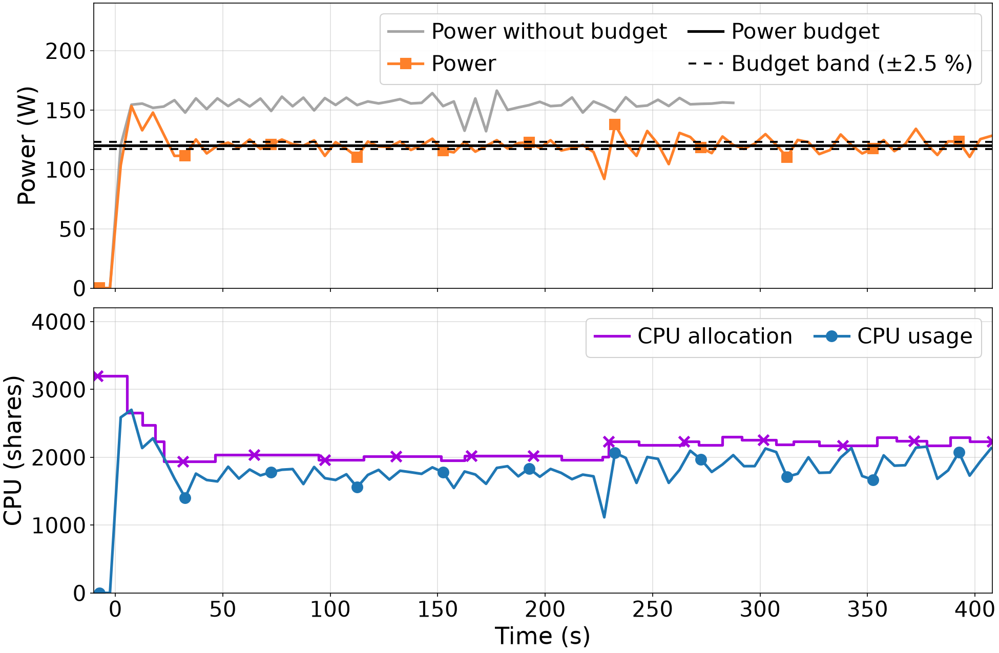
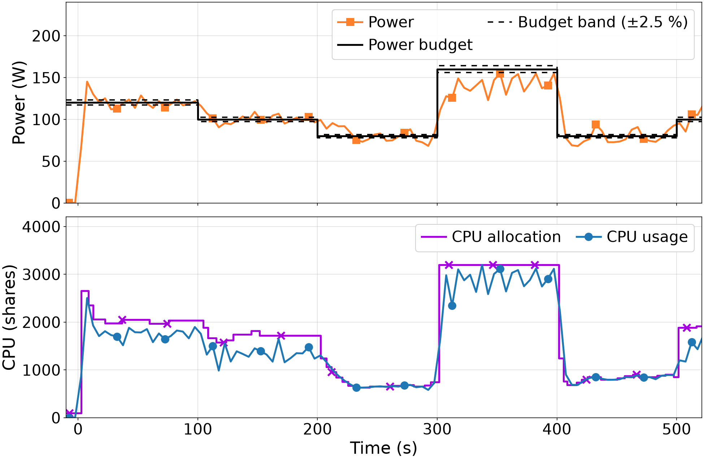
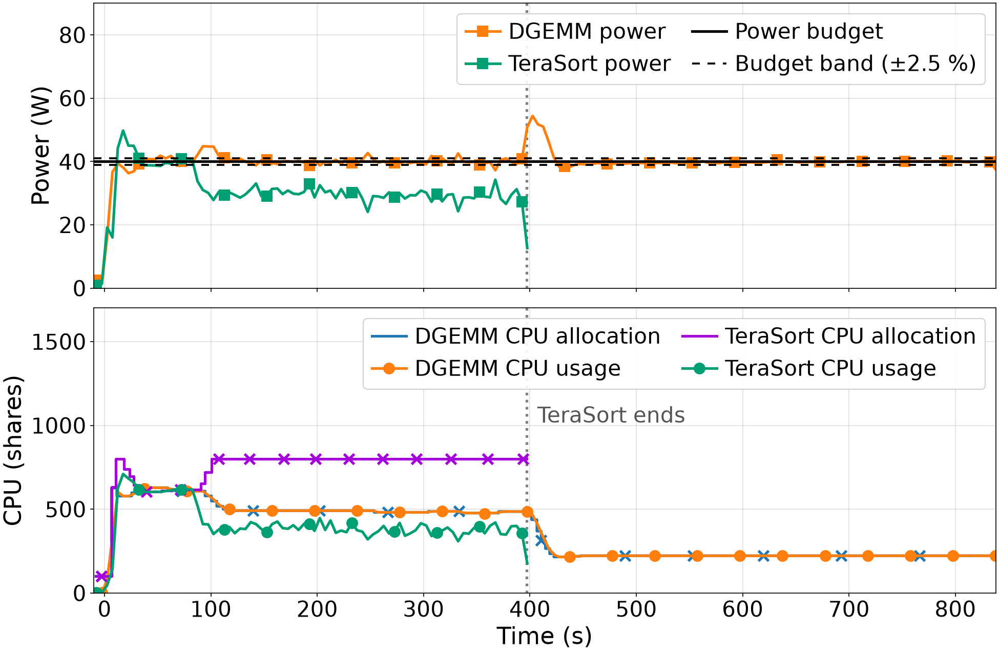

# WattsCap

WattsCap is a platform that caps the power consumption of applications running in containers. Power budgets can be set on containers, applications or users, and the platform enforces them by scaling the CPU allocation of each container in real time.

WattsCap runs Singularity/Apptainer containers on clusters with Intel or AMD CPUs. It is deployed automatically with Ansible, and it provides a web interface to manage the containers, their applications and their power budgets. It is built on [ServerlessYARN](https://github.com/UDC-GAC/ServerlessYARN) and [ServerlessContainers](https://github.com/UDC-GAC/ServerlessContainers).

- [How it works](#how-it-works)
- [Power capping methods](#power-capping-methods)
- [Examples](#examples)
- [Getting started](#getting-started)
- [Using power capping](#using-power-capping)


## How it works

WattsCap controls the power of each container through its CPU allocation, that is, the CPU time that its processes can use, in CPU shares (100 shares are one core). The control loop runs every second:

1. **Monitoring.** A lightweight agent (lite) reports different CPU metrics of each container (e.g., usage, pressure). The HwPC Sensor reads per-container Performance Monitoring Counters (PMC) ans sends this events to [StableWatts](https://github.com/UDC-GAC/stablewatts-formula), which estimates the power of each container through online power models that correlate RAPL package power with these HwPC events. Using these models, StableWatts attributes a fraction of the active power of the CPU to each container running on the worker node(s).
2. **Decision.** The EnergyManager compares the power of each container with its budget. When the power is out of a band around the budget (±2.5 % by default), it computes a new CPU allocation using the selected power capping method. This service determines both the CPU share and core allocation deemed appropriate to ensure that each container complies with its power budget, and sends this information to the NodeRescaler (or NodeRescalers) running on the hosts where the affected containers are running.
3. **Actuation.** The NodeRescaler(s) of the host(s) apply the new allocation to the container(s) via cgroups.


The EnergyManager does not react to every fluctuation of the applications:

- It smooths the power of each container with a Scaling Aware Exponential Weighted Moving Average (SA-EWMA) that is kept across scalings
- It only scales a container after several consecutive samples out of the band (events). The number of events required to perform a scaling action is dynamically determined based on the power budget deviation.
- It only scales up a container that is limited by its CPU allocation, that is, whose processes are waiting for CPU (pressure is above a threshold).

**Power budgets.** A power budget (in W) can be set on a container and adjusted at runtime. Multiple containers running on the same host can have assigned independent and asymmetric power budgets. 

**Power models.** [WattWizard](https://github.com/UDC-GAC/ServerlessContainers/tree/master/src/WattWizard) trains models of the power of the CPU as a function of its CPU usage, from training data collected with [CPUPowerWatcher](https://github.com/TomeMD/CPUPowerWatcher). The MB and MO methods use them to predict the CPU allocation that meets a budget. WattWizard trains a model for each available core distribution on the modelled host, and the EnergyManager uses the one closest to the current core distribution of each host.


## Power capping methods

| Method | `CONTROLLER` | How it changes the CPU allocation |
|---|---|---|
| Empirical value (EV) | `ev` | Multiplying the power error by a fixed ratio of CPU shares per watt (`EV_RATIO`, 10 by default). |
| TDP value (TDP) | `tdp` | Same as EV, but using a ratio derived from the TDP and the idle power of the host. |
| Proportional to the power error (PPE) | `ppe-proportional` | In proportion to the relative power error (power error/power budget) |
| Model-boosted (MB), default | `model-boosted` | Uses a power model to set the initial CPU allocation for each new budget, and uses PPE for subsequent scaling actions |
| Model-only (MO) | `model-only` | The power models set the allocation for each new budget, without PPE corrections |

MB is the default method: the power models take a container close to its budget in a single step, and PPE then absorbs the error of the models and the changes in the behaviour of the application.


## Examples

These examples were run on a node with two Intel Xeon Silver 4216 CPUs (64 logical cores) with the default configuration, that is, with MB. Each figure shows the power consumption of the containers with their budgets (top), and their CPU allocation and usage (bottom).

### Capping an application

The NPB FT kernel (class D) runs in a container that can use up to 32 cores (3,200 shares). Without a power budget, it consumes about 155 W and finishes in 289s (grey line). With a budget of 120 W, the container starts with all its CPU, so its power rises to the level of the application without budget. Five seconds after the start, MB uses the power models to set the CPU allocation for 120 W in one step (from 3,200 to about 2,650 shares), and a few scalings of PPE finally bring the container to about 1,950 shares at second 22. From then on, the power stays around the budget (120 W on average), and the allocation adjusted to the execution phases of FT. Since the CPU resources of FT are limited, its runtime increases to 408s.



### Changing the budget at runtime

Budgets can be changed at any time, and the EnergyManager applies each change within a few seconds. Here, FT starts with its minimum CPU allocation (100 shares) and a budget of 120 W, which changes every 100s to 100, 80, 160, 80 and 100 W. MB applies each new budget using the power models: 2.5 s after the start, it raises the allocation from 100 to about 2,650 shares, and when the budget drops to 80 W, it sets about 1,250 shares at once. PPE then keeps the power around each budget. A budget of 160 W is above what FT can consume, so the EnergyManager gives it all its CPU
(3,200 shares), and FT consumes what it needs until the budget drops again.



### Several applications on the same host

DGEMM, a CPU-intensive matrix multiplication, and TeraSort, an Apache Spark sort of 30 GiB, run in two separate containers on the same host with a budget of 40 W each. The power of the CPU is attributed to the containers that use it using StableWatts, so each budget applies to the power of its own application.

- DGEMM is kept at 40 W with about 490 shares.
- TeraSort stays below its budget (about 30 W): it is limited by its disk accesses and uses about 380 of the 800 shares that the EnergyManager gives it, its maximum allocation.
- When TeraSort ends (second 397), DGEMM is alone in the host, so the power that both applications shared is now attributed to DGEMM alone. Its power rises to 56 W with the same allocation, and the EnergyManager brings it back to its budget by reducing its allocation from about 490 to 220 shares in 20s. DGEMM keeps 40 W until it ends.



## Getting Started

### Prerequisites

#### For power capping

- Physical nodes with RAPL. The virtual cluster can be used to test the deployment, but its virtual machines do not expose RAPL, so their power cannot be measured.

#### For the virtual cluster deployment

- Vagrant
- VirtualBox
- Vagrant plugins: vagrant-hostmanager, vagrant-reload, vagrant-vbguest

> vagrant-reload plugin is only necessary when deploying nodes with cgroups V1, since V2 is the default installation

You may install the vagrant plugins with the following commands:
```
vagrant plugin install vagrant-hostmanager
vagrant plugin install vagrant-reload
vagrant plugin install vagrant-vbguest
```

#### For the physical cluster deployment

- Python
- Ansible
- Passwordless SSH login between nodes

> Only one cluster node (i.e. master node) needs to have Ansible installed and a passwordless SSH login to the remaining ones

### Quickstart
The platform needs to be installed and deployed on the master node (or "server" node), while the containers will be deployed on the remaining cluster nodes (workers or "hosts").

- You can clone this repository and the required frameworks with
    ```
    git clone --recurse-submodules https://github.com/UDC-GAC/WattsCap.git
    ```

- Once cloned, change directory to the root directory
    ```
    cd WattsCap
    ```

- Create configuration modules in YAML format in `ansible/provisioning/config/modules` to customize your environment (templates are provided in the same directory). Power capping is configured in `template.05-power.yml`.
    > If these configuration module files are not created, they will be created automatically during startup by copying the corresponding templates.
  
- You may deploy the virtual cluster with Vagrant (if needed):
    ```
    vagrant up
    ```

- Inside the server node (you can use `vagrant ssh` to log in when using a virtual cluster) go to the `ansible/provisioning/scripts` directory within the platform root directory (accessible from `/vagrant` on the virtual cluster). Then, execute the script to install and set up all the necessary requirements for the platform and start its services:
    ```
    bash start_all.sh
    ```
  
    > By default this script will generate an Ansible inventory considering the current configuration. You can skip this phase with the `-s` option to configure the inventory yourself.
  
    > When deploying on a physical cluster that relies on SLURM for job scheduling, the Ansible inventory will be automatically generated considering the available nodes. Again, you can skip this phase with the `-s` option.
  
- Once you are done, you can shutdown the virtual cluster (if applicable) exiting the server node and executing:
    ```
    vagrant halt
    ```

- Or you may destroy the whole virtual cluster with:
    ```
    vagrant destroy --force
    ```

- For deployments on physical clusters relying on SLURM you may consider the sample script for sbatch provided in the `slurm` directory.

### Web Interface

Once done with the installation and launch, you can visit the web interface in your browser in `{your-server-ip}:9000/ui` (or the port specified in the config file). You will see a Home page with these subpages:

- **Containers**: Manage all the deployed containers (see resource usage, create, remove,...).
- **Hosts**: Manage all hosts as well as their containers (see containers core mapping on host, host resource usage,...).
- **Apps**: See and manage all apps as well as their associated containers (launch apps, stop apps, modify their budgets,...).
- **Users**: See and manage all users as well as their associated apps.
- **Services**: Manage all services of the platform (check services health, modify configuration parameters,...).
- **Rules**: Manage all scaling rules that are followed by the services. For power capping, EnergyManager uses its own internal rules.


## Using power capping

With the default configuration (`template.01-general.yml` and `template.05-power.yml` in `ansible/provisioning/config/modules`), WattsCap deploys Lite, StableWatts, WattWizard and the EnergyManager.

- **Power budgets.** In the web interface, set the *max* of the *energy* resource of a container (Containers), an application (Apps) or a user (Users). From the server, the same can be done with:
  
    ```
    bash ServerlessContainers/scripts/orchestrator/EnergyManager/set_budget.sh <container|application|user> <name> <budget_W>
    ```
  in the installation directory of the platform.
- **Power capping method.** In the Services page, change the power capping method of the EnergyManager service, or use `ServerlessContainers/scripts/orchestrator/EnergyManager/set_controller.sh <method>`. The same page shows its other settings, such as the allowed error, the operating period or the reaction time.
- **Visualize decisions.** The EnergyManager writes each decision to `ServerlessContainers/energy_manager.log` and `ServerlessContainers/energy_manager_trace.jsonl`, which `ServerlessContainers/src/EnergyManager/plot_trace.py` plots.

### Power models and other CPUs

- **Power models:** WattWizard trains the models when the platform starts, from the time series of the training runs, stored in InfluxDB (`influxdb_*` in `template.05-power.yml`), and their timestamps, in:

  ​	`ansible/provisioning/templates/power_budgeting/wattwizard/timestamps/<modelled_cpu>`

  **Note: The default timestamps belong to training data from our CPUs stored in our private databases. For your CPUs, collect training runs with [CPUPowerWatcher](https://github.com/TomeMD/CPUPowerWatcher), add their timestamps to that directory, and set `modelled_cpu`, `train_files` and the InfluxDB connection in `template.05-power.yml`. MB and MO need these models: without them, MB works as PPE and MO cannot apply new budgets.**

- **StableWatts:** set the idle power and the base frequency of the CPU in:

  ​	`ansible/provisioning/templates/power_budgeting/monitoring/power_meter/stablewatts/config/stablewatts-config.json`

- **TDP method:** it takes the TDP of each host from its *energy* resource (`energy_per_host` in `template.02-hosts.yml`), and the idle power from the *Idle power* setting of the EnergyManager service.

### More information
> &Oacute;scar Castellanos-Rodr&iacute;guez, Roberto R. Exp&oacute;sito, Jonatan Enes, Guillermo L. Taboada, Juan Touriño, [Serverless-like platform for container-based YARN clusters](https://doi.org/10.1016/j.future.2024.02.013). Future Generation Computer Systems, 155:256-271, February 2024.

> Tom&eacute; Maseda, Jonatan Enes, Roberto R. Exp&oacute;sito, Juan Touriño, [Automated approach for accurate CPU power modelling](https://doi.org/10.1109/CLUSTER59578.2024.00016). 26th IEEE International Conference on Cluster Computing (CLUSTER 2024), pages 97-107, 2024.


## Used tools

- [Vagrant](https://www.vagrantup.com/) - IaC tool for deploying the virtual cluster
- [VirtualBox](https://www.virtualbox.org) - VM Software to support the machines of the cluster
- [Ansible](https://www.ansible.com/) - Configuration Management Tool
- [Apptainer](https://apptainer.org/) - Singularity/Apptainer Containers management tool
- [Django](https://www.djangoproject.com/) - Web development framework
- [Python](https://www.python.org) - Programming language
- [Serverless Containers](https://bdwatchdog.dec.udc.es/serverless/) - Container resource scaling framework
- [BDWatchdog](https://bdwatchdog.dec.udc.es/monitoring/) - Resource monitoring framework
- [StableWatts](https://github.com/UDC-GAC/stablewatts-formula) - Power meter of the containers
- [WattWizard](https://github.com/UDC-GAC/ServerlessContainers/tree/master/src/WattWizard) - Power modelling tool
- [CPUPowerWatcher](https://github.com/TomeMD/CPUPowerWatcher) - Collection of power and CPU usage time series to train the power models


## Authors

* **Tom&eacute; Maseda Dorado** (https://gac.udc.es/~tome/)
* **Roberto R. Exp&oacute;sito** (https://gac.udc.es/~rober/)
* **Jonatan Enes** (https://gac.udc.es/~jonatan/)
* **Juan Touriño** (https://gac.udc.es/~juan/)


## License

This project is distributed as free software and is publicly available under the GNU GPLv3 license (see the
[LICENSE](LICENSE) file for more details).
